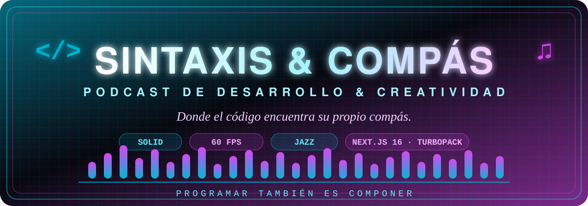

<div align="center">



# Sintaxis & Compás

### Donde el código encuentra su propio compás.
Programar también es componer.

<br/>


<br/>


</div>

---

## 👤 Autoría

> **Creado y desarrollado por [Patricia Aparicio Díaz](https://github.com/apariciodiazpatricia)** ✦ ingeniería, diseño y dirección del show.

| | Anfitriona / Anfitrión | Rol |
|---|---|---|
| 🎙️ | **Carlos Márquez** | *Lead Frontend & Productor de Audio* |
| 🎙️ | **Patricia Aparicio** | *Cloud Architect & Compositora Sonora* |

---

## ✨ Qué contiene la plataforma

- 🎧 **Reproductor de audio nativo** — HTML5 puro con **ecualizador animado**, selector de **velocidad (1x · 1.25x · 1.5x)**, **scrubber neón** arrastrable, volumen/mute y autodetección de formato `.m4a ↔ .mp3`. Cero librerías de audio, cero voces sintetizadas.
- 🎙️ **4 episodios originales en audio real generados con NotebookLM**, con sus **notas técnicas del show** y la tarjeta *📝 Temas Clave y Notas del Debate* bajo el reproductor.
- 🎼 **Paralelismos técnicos contrastados** entre ingeniería y música:

| Ingeniería | ⚖️ | Música |
|---|:---:|---|
| Principios **SOLID** | ↔ | **Armonía** tonal y voces independientes |
| **React Fiber** a 60 FPS (16,7 ms) | ↔ | **Metrónomo** 4/4 a 120 BPM (500 ms) |
| **Refactor** guiado por tests | ↔ | **Solo de jazz** y vuelta al tema |
| **Event-Driven Architecture** | ↔ | **Contrapunto a 4 voces de Bach** |

- 🗺️ **Rutas completas**: inicio (`/`), catálogo con buscador y filtros (`/episodes`), sobre el show (`/about`) y contacto (`/contact`).

---

## 🗺️ Rutas

| Ruta | Página | Qué encontrarás |
|---|---|---|
| `/` | **Inicio** | Hero con narrativa, lista de episodios y reproductor embebido |
| `/episodes` | **Catálogo** | Buscador por texto, chips de categoría y «▶ Escuchar ahora» |
| `/about` | **Sobre el Show** | Quiénes son Carlos y Patricia, cabina y stack del programa |
| `/contact` | **Contacto** | Formulario neón (nombre, correo, mensaje) y canales del show |

---

## 🏗️ Arquitectura técnica

### Stack

| Capa | Tecnología |
|---|---|
| Framework | **Next.js 16.4** (App Router, `Cache Components`, prefetch parcial) |
| Bundler | **Turbopack** |
| UI | **React 19.3** · Server Components por defecto |
| Estilos | **Tailwind CSS 4** (CSS-first: `@import "tailwindcss"` + `@theme inline`) |
| Lenguaje | **TypeScript 5** con `strict` |
| Audio | **`<audio>` nativo** + Web APIs del navegador |
| Audio fuente | **NotebookLM** → `public/audio/ep-0X.m4a` (+ red `.mp3`) |

### Decisiones de diseño

1. **Cyber-Studio Grid** — el fondo combina cuatro capas de `linear-gradient` (rejilla cian `rgba(6,182,212,.09)` y magenta `rgba(217,70,239,.06)`) que dibujan una cuadrícula de estudio sobre negro `#06070e`, con halos `blur-3xl` detrás de cada tarjeta.
2. **CSS custom properties + `@theme inline`** — el sistema de tokens (colores, fuentes, radios) se define en `app/globals.css` con la API de temas de Tailwind v4: sin `tailwind.config.js`, todo vive en CSS y se hereda por capas.
3. **Server Components por defecto** — solo `AudioPlayer.tsx` y las páginas con estado local (buscador, formulario) declaran `"use client"`; el resto se hidrata en el servidor para minimizar el JavaScript del cliente.
4. **Audio 100 % nativo, sin fallback de síntesis** — `src` directo sobre `episode.audioUrl`, `audio.duration`/`audio.currentTime` como única fuente de verdad de la barra y **autodetección de formato**: si el `.m4a` declarado no existe, se reintenta una vez con `.mp3` (chip *🎧 Audio de Estudio · M4A/MP3*); si faltan ambos, chip *⚠ archivo no disponible* con botón **🔄 Comprobar audio**.
5. **Contenido como datos** — todos los episodios viven tipados en `app/data/episodes.ts` (`Episode` con `audioUrl`, `duration`, `notes`, `keyTopics`), de modo que añadir un episodio es añadir un objeto y un archivo de audio.
6. **Accesibilidad y semántica** — botones con `aria-label`/`aria-pressed`, sliders reales con `role="slider"` + teclado, foco visible neón y etiquetas en español.

### Estructura de carpetas

```text
podcast-espanol/
├── app/
│   ├── components/
│   │   ├── AudioPlayer.tsx      # Reproductor HTML5 + ecualizador + temas clave
│   │   ├── Navbar.tsx           # Navegación con logotipo SVG neón y menú móvil
│   │   ├── Footer.tsx           # Canales: Spotify, Apple, YouTube, iVoox
│   │   ├── CategoryChip.tsx     # Chips de categoría reutilizables
│   │   └── PlatformIcons.tsx    # Iconos y enlaces de plataformas
│   ├── data/
│   │   └── episodes.ts          # 4 episodios tipados (audioUrl, notes, keyTopics)
│   ├── episodes/page.tsx        # Catálogo con buscador y filtros
│   ├── about/page.tsx           # Sobre el show
│   ├── contact/page.tsx         # Formulario de contacto
│   ├── globals.css              # Cyber-Studio Grid + tokens @theme
│   ├── layout.tsx               # Shell: Navbar + Footer + metadata
│   └── page.tsx                 # Portada
├── specs/                       # Especificación guiada paso a paso (SDD)
│   ├── 01-constitution.md       # Principios rectores y calidad
│   ├── 02-specify.md            # El QUÉ (especificación sin stack)
│   ├── 03-clarify.md            # Decisiones y dudas resueltas
│   ├── 04-plan.md               # El CÓMO (arquitectura técnica + stack)
│   └── 05-tasks.md              # Desglose de tareas y trazabilidad BDD
├── public/
│   ├── audio/                   # ep-01…ep-04 (.m4a + red .mp3) — NotebookLM
│   └── banner.svg               # Cabecera animada de este README
├── tests/bdd/                   # Especificaciones Gherkin
├── next.config.ts
├── tsconfig.json
└── package.json
```

---

## ⚡ Puesta en marcha

```bash
npm install     # dependencias
npm run dev     # desarrollo → http://localhost:3000
npm run build   # compilación de producción
npm run start   # servidor de producción
```

> Para publicar un nuevo episodio: suelta su archivo en `public/audio/ep-0X.m4a` y añade su objeto en `app/data/episodes.ts`. El reproductor lo detecta solo.

---

## 📐 Especificación y Metodología (SDD)

El proyecto se diseñó e implementó siguiendo una metodología de desarrollo guiada por especificaciones (**Spec-Driven Development**), documentada en cinco fases previas a la construcción del código:

| Fase | Documento maestro | Propósito y regla de oro |
|---|---|---|
| **1. Constitution** | [`specs/01-constitution.md`](./specs/01-constitution.md) | Principios innegociables: accesibilidad WCAG 2.2 AA, audio web nativo, arquitectura limpia y paleta Cyber-Studio. |
| **2. Specify** | [`specs/02-specify.md`](./specs/02-specify.md) | **El QUÉ funcional**: casos de uso CU-1 a CU-4 *(estrictamente sin mención de frameworks ni librerías)*. |
| **3. Clarify** | [`specs/03-clarify.md`](./specs/03-clarify.md) | Decisiones y dudas clave resueltas antes del desarrollo (fallback .m4a ↔ .mp3, cálculo de tiempos, reactividad). |
| **4. Plan** | [`specs/04-plan.md`](./specs/04-plan.md) | **El CÓMO + Stack**: arquitectura técnica Next.js 16.4, React 19, TypeScript estricto, Tailwind v4 y Web Audio API. |
| **5. Tasks • Analyze** | [`specs/05-tasks.md`](./specs/05-tasks.md) | Desglose de 23 tareas (T-01 a T-23) ordenadas por fases y vinculadas directamente con los escenarios BDD. |

---

## 🧪 Pruebas BDD

Las especificaciones viven en **`tests/bdd/*.feature`** (locale `es`) y se reproducen aquí completas. Palabras clave: **Given** = Dado · **When** = Cuando · **Then** = Entonces · **And** = Y.

### 🎧 `reproduccion-de-audio.feature`

```gherkin
Feature: Reproducción de audio nativo
  As a listener
  I want to play episodes with the native HTML5 player
  So that I hear the real studio audio without any synthetic voice

  Scenario: Play with the neon button
    Given I am on the home page with episode 1 loaded in the player
    And the status bar says "en pausa"
    When I press the neon play button
    Then the local audio file starts playing
    And the status bar changes to "sonando"
    And the mini equalizer animates while it plays

  Scenario: Pause and resume from the same button
    Given episode 1 is playing
    When I press the neon play button
    Then the audio pauses
    And the current time is preserved
    When I press the button again
    Then playback continues from the paused position

  Scenario: Instant load when choosing an episode
    Given I am on the home page with the four episodes listed
    When I press "Reproducir este episodio" on episode 3
    Then the player requests the file "/audio/ep-03.m4a"
    And playback starts without reloading the page
    And the title and key topics update to episode 3

  Scenario: Read real duration and current time
    Given episode 2 is playing
    When the browser delivers the audio metadata
    Then the shown duration equals "audio.duration"
    And the elapsed time comes from "audio.currentTime"
    And the progress bar can jump to any position

  Scenario Outline: Change playback speed
    Given episode 1 is playing
    When I select the speed "<speed>"
    Then "audio.playbackRate" becomes <value>
    And playback continues without interruption

    Examples:
      | speed  | value |
      | 1x     | 1     |
      | 1.25x  | 1.25  |
      | 1.5x   | 1.5   |

  Scenario: Adjust volume and mute
    Given episode 1 is playing
    When I move the volume control to 50 %
    Then the audio level is set to 0.5
    When I press the mute button
    Then the audio is muted without stopping playback

  Scenario: Format auto-detection when the .m4a is missing
    Given the file "/audio/ep-03.m4a" does not exist in public/audio
    When the player tries to load the declared source
    Then it automatically retries with "/audio/ep-03.mp3"
    And the indicator shows "Audio de Estudio · MP3"
    And the audio plays normally

  Scenario: No local file available
    Given the ".m4a" and ".mp3" formats of the current episode are missing
    When I try to play the episode
    Then the indicator shows "archivo no disponible (.m4a / .mp3)"
    And a "Comprobar audio" button is offered to retry
    And the browser speech synthesis is never invoked

  Scenario: Recovery with the Check audio button
    Given the player is in the "archivo no unavailable" state
    And the file "/audio/ep-03.m4a" exists again
    When I press "Comprobar audio"
    Then the indicator returns to "Audio de Estudio · M4A"
    And pressing play sounds the local file
```

### 🧭 `navegacion.feature`

```gherkin
Feature: Navigation between routes and player continuity
  As a site visitor
  I want to move through the four show routes
  So that I can explore the catalogue without losing control of the audio

  Scenario: Navigate from home to the catalogue
    Given I am on the home page "/"
    When I press "Episodios" in the navigation bar
    Then the "/episodes" route is displayed
    And the search box and category filters are visible

  Scenario: Navigate to the show page
    Given I am on any route
    When I press "Sobre el Show" in the navigation bar
    Then the "/about" route is displayed
    And the cards for hosts Carlos Márquez and Patricia Aparicio appear

  Scenario: Navigate to the contact form
    Given I am on the home page
    When I press "Contacto" in the navigation bar
    Then the "/contact" route is displayed
    And the form accepts name, email and message

  Scenario: The navigation bar highlights the active route
    Given I am on the "/episodes" route
    Then the "Episodios" link is highlighted as active
    And the other links remain idle

  Scenario: Change episode without leaving the page
    Given I am on "/episodes" with episode 1 playing
    When I press "Escuchar ahora" on episode 4
    Then the player loads "/audio/ep-04.m4a"
    And playback starts immediately
    And the "Temas Clave y Notas del Debate" card shows episode 4 topics

  Scenario: The player keeps the active episode between views
    Given I started playing episode 2 from the home page
    When I come back to the home page from "/about"
    Then the player is still bound to episode 2
    And its controls remain usable

  Scenario: Direct access by URL
    Given I open the address "/contact" directly
    Then the page renders without errors
    And the navigation bar and the footer are present
```

### 🔍 `filtrado-y-busqueda.feature`

```gherkin
Feature: Filtering and search in the episode catalogue
  As a listener
  I want to filter episodes by text or category
  So that I can quickly find the topic I care about

  Scenario: Search by text in the catalogue
    Given I am on the "/episodes" route
    When I type "arquitectura" in the search box
    Then only episodes whose title, description or notes contain "arquitectura" are shown
    And the player keeps the episode that was playing

  Scenario: Filter by category with the chips
    Given I am on "/episodes" with all episodes visible
    When I press the "Frontend" chip
    Then only the Frontend episode remains visible
    When I press the "Todos" chip
    Then the four episodes are shown again

  Scenario: Combine text and category
    Given I am on the "/episodes" route
    When I type "jazz" in the search box
    And I select the "Carrera" chip
    Then only the episode matching both conditions is shown

  Scenario: No results for the search
    Given I am on the "/episodes" route
    When I type "zzzz-no-existe" in the search box
    Then the list becomes empty
    And a message indicates there are no matching episodes

  Scenario: Filtering does not interrupt playback
    Given episode 3 is playing
    When I filter by the "Arquitectura" category
    Then the audio keeps playing without restarting
    And when clearing the filter episode 3 is still bound to the player
```

---

## 📜 Historial de versiones

```text
chore: inicializar estructura Next.js 16 con App Router y Tailwind v4
feat(theme): implementar sistema de diseño Cyber-Studio Neón y cuadrícula
feat(components): crear Navbar con logotipo SVG y Footer con canales
feat(audio): crear reproductor interactivo con controles de audio nativo
feat(content): integrar 4 episodios reales de NotebookLM y notas técnicas
feat(routes): implementar catálogo /episodes, página /about y /contact
test(bdd): definir escenarios Gherkin para flujos de audio y navegación
docs: añadir README técnico de alta fidelidad con arquitectura completa
```

---

<div align="center">

### Donde el código encuentra su propio compás. 
Programar también es componer.

**Sintaxis & Compás** — © 2026 Patricia Aparicio Díaz · 


</div>
